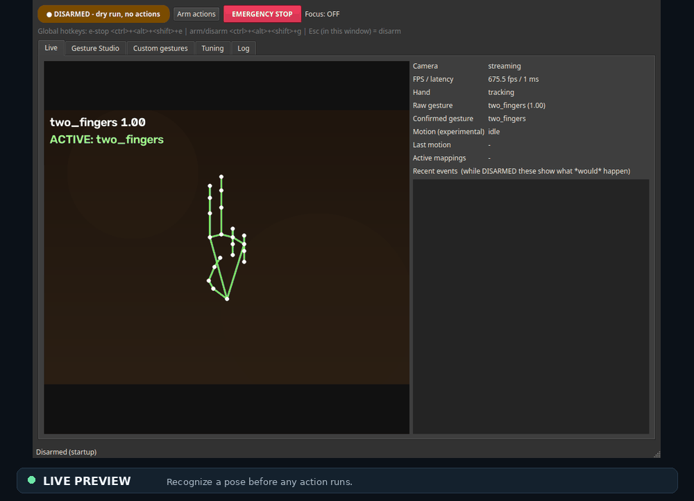

<div align="center">

# ORBIT Gesture Studio

### A webcam. A gesture. Your desktop.

Map hand gestures to desktop actions, preview them live, and stay in control with
disarmed-by-default safety.



<br>

**Python 3.10+** · **Windows · Linux · macOS** · [MIT License](LICENSE)

</div>

> The demo uses a simulated camera preview and synthetic hand landmarks. It shows the
> application interface, not a real-world accuracy demonstration.

## What ORBIT does

ORBIT tracks **one hand** with MediaPipe and turns recognized gestures into actions you
choose in Gesture Studio.

- Recognizes built-in poses: open palm, fist, and one, two, or three fingers.
- Record your own static-pose gestures and map them to actions.
- Try experimental motion gestures: swipes, waves, circles, and custom motions.
- Preview recognition, tune thresholds, and test mappings before using them.
- Starts **disarmed**. No mapped action runs until you arm it.
- Uses an explicit action allowlist; mappings cannot run shell commands or scripts.

### Available actions

| Action | What it does |
|---|---|
| Focus mode | Show a screen-edge vignette while the gesture is active |
| Keyboard shortcut | Send an approved, configurable key combination |
| Snap window | Move the active window left or right |
| Show desktop | Minimize windows or restore them |
| Window overview | Open the operating system's task/window view |
| Log message | Safely test a gesture without controlling the desktop |

Operating-system shortcut support varies. Linux synthetic input and global hotkeys work best
in an **X11** session; Wayland restricts them. macOS keyboard actions require Accessibility
permission. Window-management shortcuts can be customized in `settings.json`.

## Get started

You need **Python 3.10 or newer** and a webcam. Python 3.11 or 3.12 is recommended for
MediaPipe wheel availability.

### Windows (PowerShell)

```powershell
git clone https://github.com/kaus-thetaa/orbit-gesture-studio.git
cd orbit-gesture-studio
py -3.11 -m venv .venv
.\.venv\Scripts\Activate.ps1
python -m pip install --upgrade pip
python -m pip install -e ".[dev]"
```

### Linux or macOS

```bash
git clone https://github.com/kaus-thetaa/orbit-gesture-studio.git
cd orbit-gesture-studio
python3 -m venv .venv
source .venv/bin/activate
python -m pip install --upgrade pip
python -m pip install -e ".[dev]"
```

On Debian or Ubuntu, `bash scripts/setup_linux.sh` can install system libraries and set up
the environment.

Launch Gesture Studio:

```bash
python -m orbit
```

The MediaPipe hand model downloads from Google's model storage the first time ORBIT starts.
To check your setup or download it ahead of time:

```bash
python -m orbit doctor
python -m orbit cameras
python -m orbit download-models
```

## Use it safely

1. Keep ORBIT **disarmed** and open the **Live** tab.
2. Position your hand in view and check the raw and confirmed gesture labels.
3. Use **Gesture Studio** to enable or create a mapping. Test it while disarmed.
4. Arm actions only when you are ready to use them.

The emergency-stop button and `Ctrl+Alt+Shift+E` disarm ORBIT and release active actions.
`Ctrl+Alt+Shift+G` toggles arm/disarm; `Esc` in the ORBIT window disarms. The headless
`python -m orbit run --armed` mode executes actions—use it deliberately.

## Configuration and privacy

Mappings and settings are validated before use. Invalid mappings are reported, not executed.
See [`config/example_mappings.json`](config/example_mappings.json) for the mapping format;
`python -m orbit check-config` validates your local configuration.

Settings, mappings, custom gesture samples, downloaded models, and logs live outside the
repository in the platform's user-data directory. Set `ORBIT_HOME` to use another directory.
Camera frames are processed in memory and aren't saved or sent to a service. The hand model
download is ORBIT's only network access.

## Project status

Static hand poses are the primary gesture-control path. Motion gestures are **experimental**:
they have synthetic test coverage but have not been validated for accuracy with real users
and webcams. Recognition depends on lighting, camera placement, hand orientation, and
threshold tuning. Tests do not certify hardware behavior on a particular machine.

## Guides and development

- [Calibration](docs/CALIBRATION.md)
- [Motion gestures](docs/MOTION_GESTURES.md)
- [Troubleshooting](docs/TROUBLESHOOTING.md)
- [Example mappings](config/example_mappings.json)

Run tests with:

```bash
python -m pytest -q
```

Tests use synthetic landmarks and fake devices; they don't need a webcam or a downloaded
model.

## License

Distributed under the [MIT License](LICENSE).
