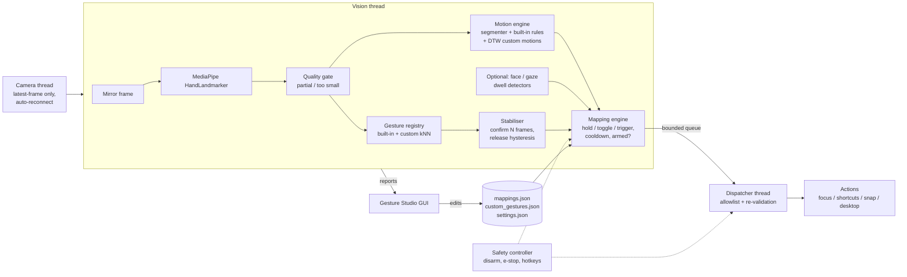

# ORBIT Gesture Studio

Webcam-powered, **user-configurable gesture control** for your desktop. ORBIT tracks one hand with
MediaPipe, classifies the pose from landmark *geometry*, and maps confirmed gestures to a small set of
**allowlisted** desktop actions. Mappings live in JSON and are edited in the **Gesture Studio** GUI - no
source changes needed. You can also record your own static-pose gestures.

> Status: early (v0.1.0). Built for a Windows laptop; Linux/macOS are best-effort. See
> [Status & honesty](#status--honesty) for exactly what has and hasn't been verified.

<!-- TODO: add a demo GIF to docs/media/demo.gif and uncomment:

-->

## Why

Keyboard shortcuts are fast but need a free hand on the keyboard. A webcam is already on every laptop, and a
raised hand is an easy, visible signal. ORBIT is an exercise in making that **reliable** rather than flashy:
confidence thresholds, multi-frame confirmation, hold/release hysteresis, cooldowns, and a safety layer so a
misdetection can't do anything surprising.

## Features

| Feature | State |
|---|---|
| Webcam capture with auto-reconnect, clean shutdown | Implemented |
| Hand landmarks (MediaPipe Tasks) + geometric gesture classification (open palm, fist, one/two/three fingers) | Implemented |
| Confidence thresholds, N-frame confirmation, release hysteresis, cooldowns | Implemented |
| `hold`, `toggle`, `trigger` activation modes | Implemented |
| JSON mappings, validated, persisted outside the repo | Implemented |
| Gesture Studio GUI (view/add/edit/delete/enable mappings, live dry-run, manual test) | Implemented |
| Focus mode (click-through screen-edge vignette + status) | Implemented |
| Actions: focus, keyboard shortcut, snap window left/right, show desktop, window overview, log message | Implemented (OS support varies - table below) |
| Custom **static-pose** gestures: record, review/reject samples, live test, save | Implemented |
| **Motion gestures**: built-in swipes (4 directions), wave, circles (cw/ccw) | Implemented (synthetic-tested; tune on real hands) |
| **Finger on lips -> mute** (`finger_on_lips`, runs the face model only when a one-finger pose is seen) | Implemented (synthetic-tested; needs the face model) |
| **Assistant**: Gemini online / Ollama offline, shared memory, one-line answers, router with failover & hedging | Implemented (tested against fake servers; not yet run against live Gemini/Ollama) |
| **Routines**: auto-fetch the mess menu when online; instant "what's for snacks" | Implemented (HTML/text; PDF/image/login pages not supported) |
| **Always-on-top orb** (ask box, one-line answers, status colour) | Implemented (offscreen-tested; check on your desktop) |
| **Custom motion gestures** (record 20-30 examples; DTW matching with augmentation, live test) | Implemented (synthetic-tested) |
| Global emergency stop + arm/disarm hotkeys, always starts disarmed | Implemented |
| Gaze (left/right) signals with calibration + dwell | **Experimental**, off by default |
| Face-blendshape signals (e.g. `jawOpen`) | **Experimental**, off by default |
| Learned sequence model for complex motions | Planned - only if DTW proves insufficient |
| "Restore workspace" action | Planned |

### Action support by OS

| Action | Windows | Linux (X11) | macOS |
|---|---|---|---|
| `focus` | yes | yes | yes |
| `keyboard_shortcut` | yes | yes | yes (needs Accessibility permission) |
| `snap_window_left/right` | `Win+Left/Right` | `Super+Left/Right` (GNOME-like) | not supported by default |
| `show_desktop` | `Win+D` | `Super+D` | `F11` (configurable) |
| `window_overview` | `Win+Tab` | not supported by default | `Ctrl+Up` |

Window management sends the OS's *own* shortcuts. Override any of them in `settings.json` under
`safety.platform_shortcuts`. Wayland blocks synthetic key events; use an X11 session on Linux.

## Architecture



Webcam processing and action execution run on **different threads**; a slow action cannot stall capture.

## Install

Requires Python 3.10+ (3.11 or 3.12 recommended) and a webcam.

```powershell
# Windows PowerShell
git clone https://github.com/<your-username>/orbit-gesture-studio.git
cd orbit-gesture-studio
py -3.11 -m venv .venv
.\.venv\Scripts\Activate.ps1
python -m pip install --upgrade pip
pip install -r requirements.txt
pip install -e .
python -m orbit doctor            # environment report
python -m orbit download-models   # fetches the MediaPipe hand model (first run does this automatically)
python -m orbit                   # launches Gesture Studio
```

**Debian / Ubuntu:** `bash scripts/setup_linux.sh` (installs the Qt/camera system libraries, creates `.venv`,
installs ORBIT, prints a report and downloads the model). **Use an X11 session** - Wayland blocks the synthetic
key events ORBIT relies on. See [docs/TROUBLESHOOTING.md](docs/TROUBLESHOOTING.md#linux--debian).

macOS: `python3 -m venv .venv && source .venv/bin/activate`, then the same pip commands.

User data (settings, mappings, custom gestures, models, logs) lives **outside the repo**:
`%APPDATA%\ORBIT Gesture Studio` on Windows, `~/.config/orbit-gesture-studio` on Linux,
`~/Library/Application Support/ORBIT Gesture Studio` on macOS (override with `ORBIT_HOME`).

## Using it

1. Launch. ORBIT starts **DISARMED** (dry run): the camera and recognition run, and the Live tab shows what
   *would* fire, but no action executes.
2. Hold two fingers up. Watch *Raw gesture* → *Confirmed gesture* in the Live tab.
3. Click **Arm actions**. Two fingers now activates Focus mode while held and releases when you lower them.
4. **Emergency stop**: button, or `Ctrl+Alt+Shift+E` anywhere. `Ctrl+Alt+Shift+G` toggles arm/disarm.
   `Esc` in the ORBIT window disarms.

Headless/debug: `python -m orbit run --preview` (dry run) or `--armed`.

## Mapping format

`mappings.json`:

```json
{
  "version": 1,
  "mappings": [
    {"id": "focus-two-fingers", "gesture": "two_fingers", "action": "focus",
     "mode": "hold", "params": {"dim": 35}, "enabled": true, "cooldown_ms": 500},
    {"id": "snap-left-one-finger", "gesture": "one_finger", "action": "snap_window_left",
     "mode": "trigger", "params": {}, "enabled": true, "cooldown_ms": 1500},
    {"id": "browser-tab", "gesture": "three_fingers", "action": "keyboard_shortcut",
     "mode": "trigger", "params": {"keys": "ctrl+shift+t"}, "enabled": true, "cooldown_ms": 1500}
  ]
}
```

* `mode`: `hold` (active while held), `toggle` (each confirmed gesture flips state), `trigger` (once).
  Each action declares which modes it supports.
* `gesture`: static built-ins (`open_palm`, `fist`, `one_finger`, `two_fingers`, `three_fingers`), motion built-ins
  (`swipe_left/right/up/down`, `wave`, `circle_cw`, `circle_ccw`), any custom static or motion gesture you recorded, or
  experimental signals `gaze_left`, `gaze_right`, `face_<name>`. Motions accept `trigger` or `toggle` only.
* One *enabled* mapping per gesture. Invalid entries are skipped (and reported), never executed.

## Safety & privacy

* **No shell, no eval.** Mappings can only reference registered actions with validated parameters; there is no
  field that accepts a command line. A test scans the source for `subprocess`, `os.system`, `eval`, `exec`.
* Shortcuts are parsed against a closed vocabulary; a denylist blocks combos like `Alt+F4`, `Win+L`, `Win+R`,
  `Ctrl+W` (configurable).
* Starts **disarmed**; nothing disruptive happens at startup. Disarm/e-stop releases anything currently held.
* Camera frames are processed in memory and never saved. Custom gestures store landmark *numbers* only.
  Nothing leaves your machine, except the one-time model download from Google's MediaPipe storage.
* Windows can't inject keys into windows running as Administrator unless ORBIT is also elevated.

## Tests

```bash
pip install -r requirements-dev.txt
python -m pytest -q
```

Tests use synthetic landmarks, a fake camera and a fake keyboard, plus offscreen Qt smoke tests. They need no
webcam or model file.

## Status & honesty

* Verified in the development environment (Linux, Python 3.12, MediaPipe 1.1.0, PySide6 6.12): the full test
  suite (motion gestures use synthetic trajectories), CLI commands, and the MediaPipe Tasks API surface this code uses.
* Verified on a real webcam (Debian/Ubuntu, Wayland, dry run): live hand tracking, and clean press/release events for
  open palm, fist, one/two/three fingers.
* **Not yet verified on real hardware:** live webcam inference, accuracy of the default thresholds with real
  hands, real key injection on Windows, the Focus overlay rendering on real displays. Thresholds are
  starting values - calibrate them ([docs/CALIBRATION.md](docs/CALIBRATION.md)).
* No benchmarks are published because none have been measured.

## Not planned

* Automating logged-in consumer chat websites (Gemini/Claude/ChatGPT) or rotating between accounts to get around
  usage limits. Those services' terms restrict automated access and limit-evasion, and storing multiple account
  sessions is a security risk. Use official APIs with your own keys instead.

## Limitations

* Motion gestures are 2D palm trajectories with ~0.25 s latency; no depth, one hand. Complex motions with few examples may need a learned sequence model.
* Fingers pointing at the camera look short (foreshortening) and can be misread; keep the palm roughly facing
  the camera.
* One hand at a time. Thumb state is ignored by the built-in poses on purpose.
* Gaze is an eye-in-head approximation and sensitive to head movement, glasses and lighting.
* `show_desktop` tracks its own state; manually toggling the desktop can desynchronise it.

## Roadmap

Learned sequence model (if needed) · restore-workspace action · per-app profiles · gaze
calibration inside the GUI · packaged installer.

## Docs

[Assistant](docs/ASSISTANT.md) · [Calibration](docs/CALIBRATION.md) · [Motion gestures](docs/MOTION_GESTURES.md) · [Troubleshooting](docs/TROUBLESHOOTING.md) · [Gaze & face](docs/GAZE_AND_FACE.md)

## License

Not yet chosen.
